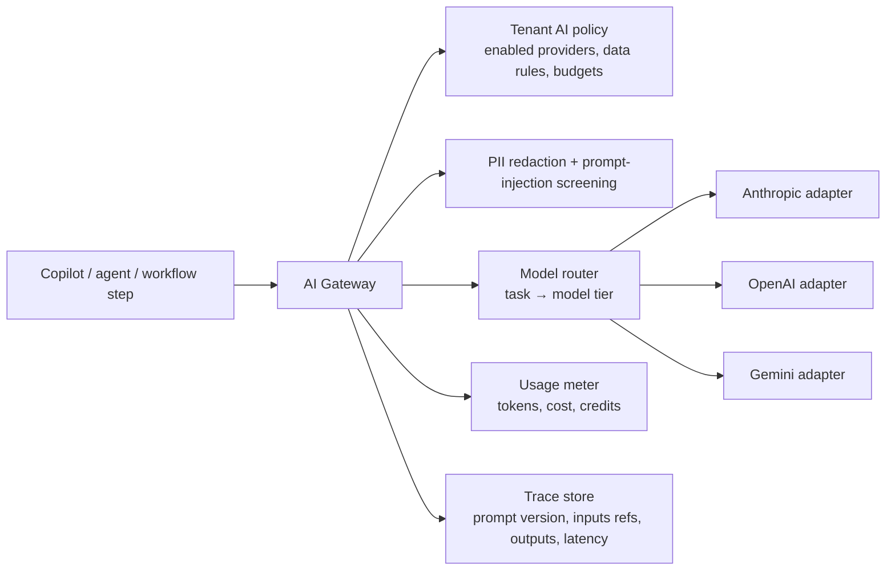
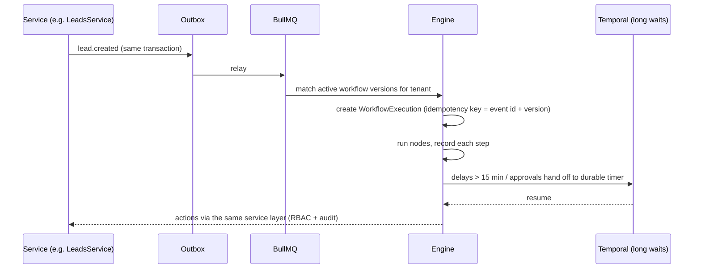

# AI Agent and Automation Architecture

**Status:** the automation engine (section 6) shipped in Phase 3 and the AI layer in Phase 4. Sections 2 to 5
are the target design; the table below says what is built today and where it differs. See ADR 0008.

### Built in Phase 4

| Design item | Built |
|---|---|
| AI gateway | `apps/api/src/ai/gateway.service.ts` (a module in the API, not yet a separate `packages/ai`). Preflight order: workspace kill switch, agent switch, provider configured, credits, per-user rate limit. Every call writes an `ai_usage` row that the app role cannot update or delete |
| Providers | Anthropic only, through the official SDK (`@anthropic-ai/sdk`), default model `claude-opus-5-5` (`AI_MODEL`). Server-side fallbacks are enabled (`AI_SERVER_FALLBACKS`). The `ModelProvider` interface allows other adapters later |
| Model tiers | `fast`, `balanced`, `deep` map to the API's effort setting (low, medium, high) on one model, not to different models |
| Metering | Credits = max(1, ceil((input + 6 × output tokens) / 6000)) × tier multiplier (fast 1, balanced 2, deep 4). Allowance = plan credits × active seats, optionally lowered by an admin cap |
| Prompt versioning and evals | `prompts.ts` holds versioned prompts and JSON schemas; runs and recommendations store the version; `apps/api/evals` has four golden datasets with deterministic scorers |
| Prompt-injection defence | Email and pasted notes are wrapped as `<untrusted_data>`; Copilot proposals made after reading external content are flagged to the person; every change needs the person's confirmation anyway |
| Redaction | Optional per workspace: emails, phone and card-like numbers become placeholders before the call and are restored in the answer (card numbers are never restored) |
| Rate limiting | Per user, counted in the database (`AI_USER_CALLS_PER_MINUTE`), not Redis |
| Agents | Copilot, Lead Qualification (manual or automatic on `lead.created` through the worker), Deal Intelligence, Meeting notes (pasted notes, no recording), Proposal draft, Workflow builder, Forecast explainer. Settings live in `ai_settings`; runs in `ai_runs`; results in `ai_recommendations` |
| Action tiers | Tier 0 reads run immediately. Tier 1 drafts are stored as recommendations. Tier 2 writes (task, note, deal stage) are proposals the person confirms, re-checked against their permissions at confirm time. Tier 3 and tier 4 actions are not exposed as tools at all |
| Copilot | Bounded tool loop (6 steps) over read tools filtered by the caller's role, with citations. Answers are not streamed yet |
| Not built | RAG/pgvector, scheduled agents (nightly, weekly), Sales Research, Outreach, Customer Success, Coaching, CRM Administrator, Data Quality and Workflow Optimization agents, bring-your-own provider keys |

## 1. Principles

1. **Agents are workflow actors, not a separate system.** An agent run is a workflow execution whose steps
   include model calls. It shares the same logs, retries, approvals, rate limits and kill switches.
2. **Tools, not free text, change data.** Models can only act by calling typed tools from an allowlist.
   Every tool call is authorized as the requesting user (or the agent's service identity) against RBAC.
3. **Approval tiers are decided by the tool, not by the model.**
4. **Explainability is stored, not generated after the fact.** Each recommendation keeps the record ids,
   signals and prompt version that produced it.
5. **Bounded execution.** Every run has step, token, time and cost ceilings.

## 2. AI gateway (`packages/ai`)

| Capability | Design |
|---|---|
| Provider independence | One `ModelProvider` interface (`generate`, `stream`, `embed`, `toolCall`); adapters per vendor; capabilities declared per model |
| Model routing | Tasks declare a tier (`fast`, `balanced`, `deep`); tenant policy maps tiers to allowed models; automatic fallback to the next allowed provider on outage |
| Token tracking and metering | Usage recorded per call (tenant, user, agent, model, tokens in/out, cost); converted to SampForce AI credits; budgets checked before the call |
| Prompt versioning | Prompts are files with semantic versions and eval suites; every trace stores the version |
| RAG | Embeddings (not stored yet; Atlas Vector Search or a separate index) scoped by workspace like every collection; retrieval filters by the caller's record-level access, not just tenant |
| Prompt-injection defence | Retrieved content and emails are wrapped as untrusted data; tool calls derived from untrusted content always require approval; output schemas are validated |
| Sensitive-data redaction | Configurable detectors (emails, phones, IDs, card-like numbers) applied before sending to providers when tenant policy requires |
| Rate limiting | Per tenant, per user and per agent token buckets in Redis |
| Tenant configuration | Provider keys (bring-your-own or platform), data-retention flags, allowed models, monthly budget, per-agent enablement |
| Evaluation | Golden datasets per prompt; CI runs evals on prompt changes; production sampling with human ratings |

## 3. Action tiers

| Tier | Examples | Execution |
|---|---|---|
| 0 Read | Search deals, summarize activity, compare months | Immediate, if the user can read the data |
| 1 Internal draft | Draft email, draft workflow, propose lead score | Immediate; result saved as a draft, nothing external happens |
| 2 Internal write | Update a field, create a task, assign owner | Immediate for the user's own records with undo; otherwise approval |
| 3 External or financial | Send email/SMS, change price or discount, generate contract, call webhook | Always an `ApprovalRequest` to an authorized human |
| 4 Prohibited for agents | Mass communication without a reviewed campaign, export sensitive data, change security settings or roles, modify contractual prices | Not exposed as tools |

## 4. Agent framework

Each agent is a row in `AIAgent` with: purpose, enabled flag, tool allowlist, model tier, max steps, max
cost per run, monthly budget, approval policy, schedule/triggers, and owner. Runs are `AIAgentExecution`
rows with every step, tool call, approval, token count, cost and outcome.

| Agent | Triggers | Key tools (tier) |
|---|---|---|
| Lead Qualification | `lead.created`, manual | read lead/company (0), detect duplicates (0), propose score + owner (1), apply score (2) |
| Sales Research | Manual, before meetings | read CRM (0), fetch from approved licensed sources only (0), write account brief draft (1) |
| Outreach | Manual, sequence step | draft email/variants (1), schedule send (3) |
| Meeting | `meeting.completed` with consented recording | summarize transcript (0), extract actions (1), create tasks (2), draft follow-up (1) |
| Proposal | Deal reaches Proposal stage | populate approved template (1), select catalogue products (1), price/discount changes (3) |
| Deal Intelligence | Nightly + `deal.*` events | compute health signals (0), recommend next action (1) |
| Revenue Forecasting | Weekly, manual | build forecast + scenarios (0), explain changes (0), snapshot (2) |
| Customer Success | Nightly | health scoring (0), renewal brief (1), create follow-up task (2) |
| Sales Coaching | Manual, on consented calls | analyse interactions (0), coaching notes (1) |
| CRM Administrator | Manual | detect config issues (0), propose config change (1), apply change (3) |
| Data Quality | Nightly | find incomplete/duplicate/stale records (0), propose merges (1), merge (2 with undo window) |
| Workflow Optimization | Weekly | analyse execution logs (0), propose workflow edits (1) |

**Governance controls:** tenant isolation via the workspace guard's context on every tool; per-agent kill switch and a
tenant-wide AI kill switch (checked before every step); retry with exponential backoff for transient errors
only; per-run and monthly cost caps; human override (cancel, edit, re-run); evaluation metrics per agent
(acceptance rate of recommendations, approval rejection rate, error rate, cost per accepted action).

## 5. Copilot

Natural language → planner (model) → typed plan of tool calls → policy check per call → execute tier 0/1,
queue tier 2/3 approvals → stream answer with citations to records. Copilot can only call tools the user's
role allows; it never escalates privileges. Answers show "why" (records and metrics used).

## 6. Automation engine (`packages/automation`, Phase 3)

**Definition model.** A workflow version is an immutable JSON graph validated by a Zod schema: one trigger,
condition nodes (if/else, AND/OR, comparisons, expressions in a sandboxed expression language with no I/O),
action nodes, delay nodes (duration or business hours), parallel branches with joins, and approval nodes.

**Execution.**

| Requirement | Mechanism |
|---|---|
| Idempotency | Execution key = (event id, workflow version); action keys passed to providers |
| Loop protection | Events emitted by an execution carry its lineage; max depth 5 and per-record rate limits |
| Retry and failure handling | Per-action retry policy; failures surface on the execution log and notify the owner |
| Version control | Edits create a new version; running executions finish on their version |
| Simulation mode | Executes against a snapshot with all external actions stubbed; shows the path taken |
| Rate limits | Per tenant and per action type; plan allowance for monthly runs |
| Compensation | Actions declare an optional compensating action (e.g., unassign) used by "undo run" |
| AI workflow builder | Model produces a definition JSON validated by the schema; user reviews it in the visual editor, runs a simulation, then activates |

**Visual editor:** React Flow canvas; nodes from a typed library; inline validation; execution overlay
showing counts and failures per node.
