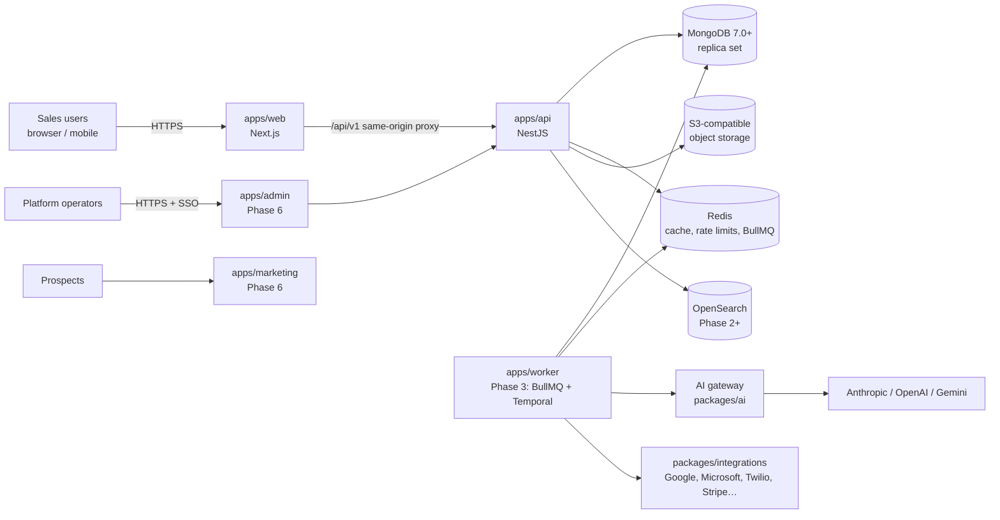

# SampForce System Architecture

**Status:** v1 (2026-10-30). Sections marked **Implemented** exist in this repository and are covered by tests.
Everything else is the target design for later phases.

## 1. Goals that drive the design

1. **Tenant isolation is enforced by the database**, not just by application code.
2. **Core CRM works without optional providers.** AI, email sync, telephony and 3D are enhancements; when
   any is down or unconfigured, records, pipelines and dashboards still work.
3. **Every consequential action is explainable and auditable**: who or what did it, why, and with whose approval.
4. **One data model, one event stream.** Sales, marketing, success, automation and AI all read and write the
   same entities and emit the same domain events.
5. **Boring, proven infrastructure**: MongoDB (replica set), Redis, S3-compatible storage, containers.

## 2. Context



## 3. Monorepo layout (Implemented)

```
dealflow/
├── apps/
│   ├── api/            NestJS REST API (auth, tenants, audit, dashboard, health, OpenAPI)
│   ├── web/            Next.js 15 App Router CRM application
│   ├── admin/          (Phase 6) operator super-console, separate deployment and auth realm
│   ├── marketing/      (Phase 6) public website
│   └── worker/         (Phase 3) background jobs and durable workflows
├── packages/
│   ├── types/          Zod schemas + shared types: one source for API validation, forms and OpenAPI
│   ├── config/         Validated environment loading
│   ├── database/       Prisma schema (MongoDB), workspace guard, index set-up, tenant-context helper, provisioning
│   ├── ui/             Design tokens, Tailwind preset, accessible primitives (Radix, shadcn conventions)
│   ├── ai/             (Phase 4) provider-independent AI gateway
│   ├── automation/     (Phase 3) workflow definition schema, engine and node library
│   ├── integrations/   (Phase 3) provider adapters with a common contract
│   ├── analytics/      (Phase 5) metric definitions and forecast models
│   └── billing/        (Phase 6) plans, entitlements, payment-provider adapters
├── infrastructure/     docker/ and helm/dealflow (Phase 8 chart); no Terraform
├── docs/               This documentation
├── scripts/            db-setup.sh and operational scripts
├── docker-compose.yml  Local MongoDB (replica set), Redis, API, web
└── .github/workflows/  CI: build, lint, typecheck, unit + integration + e2e + accessibility tests
```

Packages are introduced when their first real consumer ships, so the tree never contains empty scaffolding.

## 4. Request path (Implemented)

1. The browser calls `/api/v1/*` on the web origin. Next.js rewrites it to the API, so auth cookies are
   first-party, `SameSite=Lax` and `HttpOnly`.
2. API global guards run in order: **ThrottlerGuard** (rate limit) → **OriginGuard** (CSRF: unsafe methods
   must come from an allow-listed origin) → **AuthGuard**.
3. AuthGuard verifies the 15-minute HS256 access token (cookie or `Authorization: Bearer`), then **re-reads the
   membership and role on every request**, so revoking a member or changing a role applies immediately.
   `@RequirePermissions()` metadata is checked against the role's permission list.
4. Controllers validate input with the shared Zod schemas (`ZodPipe`) and call services.
5. Services run tenant queries through `prisma.run(ctx, fn)`, which opens a transaction and sets
   `app.tenant_id` / `app.user_id` with `set_config(..., true)` (transaction-scoped, safe with pooling).
6. The **workspace guard** in the database client (`packages/database/src/scope.ts`) adds `tenant_id` to every
   read and checks it on every write, for every collection that has one (ADR 0058; until 2026-11-09 this was
   PostgreSQL forced row-level security).
7. Audit events are written **inside the same transaction** as the change they describe.
8. Errors leave through one filter as `{ error: { code, message, requestId, details? } }`; logs are
   structured JSON (pino) with the request id and with cookies and auth headers stripped.

## 5. Authentication and sessions (Implemented)

- Passwords: argon2id (19 MiB, t=2), constant-time path for unknown emails.
- Access token: JWT, 15 min, claims `sub` (user), `tid` (active tenant), `sid` (session).
- Refresh token: 256-bit random, only its SHA-256 stored, rotated on every refresh. Re-use of a rotated token
  revokes **all** the user's sessions (theft detection). Cookie path is limited to `/api/v1/auth`.
- Multi-workspace users switch tenant with `POST /auth/switch-tenant`; membership is verified first.
- Phase 8 added TOTP two-step verification, account lockout, OIDC single sign-on, SCIM 2.0 and a device list.
  Access tokens also carry `amr` (password, mfa or sso) and, for SSO, `stid` (the workspace that signed the person in).
  The guard checks the session row on every request. WebAuthn and SAML are not built (ADR 0012).

## 6. Data layer

- MongoDB 7.0 or newer (a replica set, for transactions) with Prisma 6's MongoDB connector. Schema and ERD:
  [DATABASE.md](DATABASE.md). Why MongoDB and what replaced each PostgreSQL feature: [ADR 0058](adr/0058-mongodb.md).
- Three database users: `sampforce_admin` (index set-up), `sampforce_app` (runtime: documents only, in one database) and
  `sampforce_backup` (MongoDB's backup role).
- `pnpm db:setup` creates collections, the indexes the schema declares and the ones it cannot (partial,
  case-insensitive), and seeds the plan catalogue. There are no migrations.
- Embeddings for retrieval are not stored yet (pgvector was planned under PostgreSQL); MongoDB Atlas Vector Search
  or a separate index would hold them, scoped by workspace like everything else.
- OpenSearch (Phase 2+) indexes are partitioned by tenant (index-per-tenant for large tenants, filtered
  aliases otherwise); the indexer runs with the tenant context of the source row.
- Object storage keys are prefixed `tenants/{tenantId}/…`; uploads go through signed URLs issued after an
  authorization check; files are scanned before being made available.
- Redis keys are prefixed `t:{tenantId}:`; BullMQ job payloads always carry `tenantId`, and the job runner
  opens the tenant context before doing anything.

## 7. Domain events and background work (Phase 3)

Services publish domain events (`lead.created`, `deal.stage_changed`, …) to a transactional outbox table in
the same transaction as the change. A relay moves them to BullMQ. Consumers include the workflow engine,
notifications, search indexing, analytics snapshots and AI agents. Temporal is used only for long-running,
human-in-the-loop workflows (multi-day sequences, approvals) where durable timers matter; short jobs stay
on BullMQ. Details: [AI_AND_AUTOMATION.md](AI_AND_AUTOMATION.md).

## 8. Integrations framework (Phase 3)

Every provider adapter implements one contract: `connect` (OAuth or key), `refreshCredentials`,
`healthCheck`, `sync(cursor)`, `handleWebhook`, `disconnect`, plus declared scopes and rate limits. Credentials
are envelope-encrypted with a per-tenant data key (KMS-wrapped). Connection records hold status, last sync,
last error and scope list, which drive the Integrations page. An adapter is shown as connected only after a
successful health check with real credentials; in tests adapters run against recorded fixtures.

## 9. Frontend architecture (Implemented foundation)

- Next.js App Router; authenticated area under `/app`; middleware redirects visitors without a session.
- TanStack Query for server state (with a single-flight token refresh on 401), Zustand for UI preferences,
  React Hook Form + the shared Zod schemas for forms.
- `packages/ui` provides tokens and primitives; Motion for transitions, honouring the user's motion setting.
- 3D (React Three Fiber) arrives in Phase 7 as lazily loaded islands with a 2D/table fallback and a
  low-power switch that already exists.
- The navigation registry lists all 26 modules. Unshipped modules route to an honest roadmap page, so no
  link is broken and nothing pretends to work.

## 10. Deployment

- **Implemented:** Dockerfiles for API and web (standalone Next.js output), `docker-compose.yml` for a
  local stack, GitHub Actions CI with a database running all test suites and accessibility checks.
- **Phase 8 (done):** Helm chart with a pre-upgrade database set-up Job, HPAs, PDBs, NetworkPolicies, ServiceMonitors
  and alert rules (checked in CI, not yet installed on a cluster); Prometheus metrics and OpenTelemetry traces;
  backup and restore scripts with measured drill times; runbooks. See [DEPLOYMENT.md](DEPLOYMENT.md).
- **Not done:** read replicas, Redis, CDN configuration, blue-green deploys, PITR drills.

## 11. Degradation matrix

| Dependency down | Behaviour |
|---|---|
| AI provider | Copilot and agents show "unavailable"; queued agent tasks retry with backoff; CRM unaffected |
| Redis | Rate limits fall back to in-memory per instance; background jobs pause; requests still served |
| Email/calendar provider | Sync status turns red on the Integrations page; retries with backoff; manual logging still works |
| OpenSearch | Search falls back to the built-in word search with trigram-style ranking |
| WebGL unavailable / low-power | 2D charts and tables render instead of 3D scenes |
