# DealFlow Database Design

PostgreSQL 16. Prisma schema: [`packages/database/prisma/schema.prisma`](../packages/database/prisma/schema.prisma).
Migrations: [`packages/database/prisma/migrations`](../packages/database/prisma/migrations).

## Conventions

| Rule | Detail |
|---|---|
| Keys | UUID v4 primary keys generated by Postgres (`gen_random_uuid()`) |
| Tenancy | Every tenant-owned row has `tenant_id uuid NOT NULL` with an FK to `tenants` and an RLS policy |
| Time | `timestamptz(3)` for instants, `date` for calendar dates such as expected close |
| Money | `numeric(18,2)` + ISO-4217 `char(3)` currency on the same row |
| Audit columns | `created_at`, `updated_at`; `deleted_at` for soft deletion on user-facing records |
| Custom data | `custom_fields jsonb` on core records in Phase 1–2; typed `CustomField` definitions validate it |
| Indexes | Every query path starts with `tenant_id`, so composite indexes lead with it |
| Naming | snake_case tables and columns, Prisma models in PascalCase |

## Entity relationship diagram

Solid entities exist in the Phase 1 schema. Entities marked *(Pn)* are designed and arrive with their phase.

```mermaid
erDiagram
  Plan ||--o{ Subscription : "priced by"
  Tenant ||--|| Subscription : has
  Tenant ||--o{ Membership : has
  User ||--o{ Membership : "belongs via"
  User ||--o{ Session : has
  Role ||--o{ Membership : grants
  Tenant ||--o{ Role : defines
  Tenant ||--o{ Team : has
  Team ||--o{ TeamMember : has
  Membership ||--o{ TeamMember : "joins"
  Tenant ||--o{ AuditLog : records

  Tenant ||--o{ Company : owns
  Company ||--o{ Company : "parent of"
  Company ||--o{ Contact : employs
  Tenant ||--o{ Lead : owns
  Tenant ||--o{ Pipeline : owns
  Pipeline ||--o{ PipelineStage : "ordered stages"
  PipelineStage ||--o{ Opportunity : holds
  Company ||--o{ Opportunity : "buys via"
  Contact ||--o{ Opportunity : "primary contact"
  Opportunity ||--o{ Activity : "logged on"
  Opportunity ||--o{ Task : "follow-ups"

  Opportunity ||--o{ OpportunityContact : "buying committee (P2)"
  Opportunity ||--o{ OpportunityLineItem : "line items (P2)"
  Product ||--o{ PriceBookEntry : "priced in (P5)"
  PriceBook ||--o{ PriceBookEntry : "contains (P5)"
  Opportunity ||--o{ Quote : "quoted by (P5)"
  Quote ||--o{ Proposal : "presented as (P5)"
  Opportunity ||--o{ Contract : "closes into (P5)"
  Contract ||--o{ CustomerSuccessPlan : "managed by (P5)"
  Tenant ||--o{ Invoice : "billed (P6)"
  Subscription ||--o{ UsageRecord : "meters (P6)"

  Tenant ||--o{ Communication : "timeline (P3)"
  Communication ||--o{ EmailMessage : "email (P3)"
  Tenant ||--o{ Meeting : "calendar (P3)"
  Tenant ||--o{ Campaign : "runs (P5)"
  Campaign ||--o{ Sequence : "uses (P3)"
  Tenant ||--o{ Workflow : "automates (P3)"
  Workflow ||--o{ WorkflowVersion : "versions (P3)"
  WorkflowVersion ||--o{ WorkflowExecution : "runs (P3)"
  Tenant ||--o{ ApprovalRequest : "approvals (P3)"
  Tenant ||--o{ Notification : "notifies (P3)"
  Tenant ||--o{ IntegrationConnection : "connects (P3)"
  Tenant ||--o{ Webhook : "subscribes (P3)"
  Tenant ||--o{ AIAgent : "configures (P4)"
  AIAgent ||--o{ AIAgentExecution : "runs (P4)"
  User ||--o{ AIConversation : "chats (P4)"
  Tenant ||--o{ Forecast : "forecasts (P4)"
  Forecast ||--o{ ForecastSnapshot : "snapshots (P4)"
  Tenant ||--o{ CustomField : "extends (P2)"
  Tenant ||--o{ CustomObject : "extends (P5)"
  Tenant ||--o{ FileAttachment : "stores (P2)"
```

## Entity catalogue

| Entity | Purpose | Tenant scoped | Phase |
|---|---|---|---|
| Plan | Rate card and entitlements (reference data) | No | 1 |
| User | Global identity; email unique across the platform | No | 1 |
| Session | Hashed, rotating refresh tokens | No (per user) | 1 |
| Tenant | Workspace / organization | Self | 1 |
| Subscription | Tenant's plan, status, seats, period | Yes | 1 (billing logic P6) |
| Role | Named permission set; five system roles per tenant, custom roles later | Yes | 1 |
| Membership | User ↔ tenant with a role | Yes | 1 |
| Team, TeamMember | Sales teams and their members | Yes | 1 (UI P2) |
| AuditLog | Append-only security and business audit trail | Yes | 1 |
| Company | Accounts, with parent-child hierarchy | Yes | 1 schema / 2 UI |
| Contact | People | Yes | 1 / 2 |
| Lead | Unqualified prospects with scores, source and consent | Yes | 1 / 2 |
| Pipeline, PipelineStage | Configurable sales processes with probabilities | Yes | 1 / 2 |
| Opportunity | Deals; amount, currency, stage, status, close data | Yes | 1 / 2 |
| Activity | Calls, emails, meetings, notes (`ai_assisted` flag) | Yes | 1 / 2 |
| Task | Assignable to-dos with due dates | Yes | 1 / 2 |
| CustomField / CustomObject | Typed definitions for tenant extensions | Yes | 2 / 5 |
| FileAttachment | Object-storage metadata, scan status | Yes | 2 |
| Communication, EmailMessage, Meeting | Omnichannel timeline | Yes | 3 |
| Sequence, Campaign | Engagement and marketing | Yes | 3 / 5 |
| Workflow, WorkflowVersion, WorkflowExecution | Automation definitions, immutable versions, run logs | Yes | 3 |
| ApprovalRequest | Human-in-the-loop decisions for workflows and AI | Yes | 3 |
| Notification | In-app and email notifications | Yes | 3 |
| IntegrationConnection, Webhook | Provider connections (encrypted creds) and outbound subscriptions | Yes | 3 |
| AIAgent, AIAgentExecution, AIConversation | Agent config, runs with tool calls, cost and approvals; chat history | Yes | 4 |
| Forecast, ForecastSnapshot | Forecast definitions and immutable snapshots for the Time Machine | Yes | 4 |
| CommercialSettings | Discount approval threshold, quote validity, default terms (one row per tenant) | Yes | 5 |
| Product, PriceBook, PriceBookEntry, TaxRate | Catalogue; one default price book per currency; prices per book | Yes | 5 |
| Quote, QuoteLine | Versioned quotes (`number` + `version`, `is_latest`), lines snapshot the price, discount and tax used | Yes | 5 |
| Contract | Contract register; `renewed_from_id` links a renewal (unique, so one renewal per contract) | Yes | 5 |
| Segment | Saved audience rules over leads or contacts | Yes | 5 |
| LeadForm, FormSubmission | Hosted forms (`public_token`) and their submissions with consent text; submissions are append-only | Yes | 5 |
| ExchangeRate, SalesTarget | Manual FX rates per date; quarterly team or personal targets | Yes | 5 |
| Escalation, CompanyHealth | Customer escalations; last computed health score, band and signals per company | Yes | 5 |
| Proposal, CustomerSuccessPlan | Not built; proposals are AI drafts on the deal, plans are deferred | — | later |
| Subscription (Phase 6 columns) | Provider (`NONE`/`STRIPE`/`RAZORPAY`), provider customer and subscription ids, `cancel_at_period_end`, `past_due_since`, `trial_used_at`; status gains `UNPAID` | Yes | 6 |
| Invoice | Invoices as the provider reports them (minor units, currency, hosted and PDF links); unique per provider invoice id | Yes | 6 |
| BillingEvent | Provider event ids already processed (idempotency only; no payload stored) | Yes | 6 |
| SupportGrant | An owner's time-boxed permission for platform support, with reason | Yes | 6 |
| PlatformOperator, PlatformAuditLog | Platform staff accounts and their append-only action log (global, no tenant) | No | 6 |
| UsageRecord | Not built: usage is counted from the source tables (AI usage, workflow executions) | — | later |
| Report | Saved report definition (catalogue field keys only, never SQL), `PRIVATE` or `WORKSPACE` | Yes | 7 |
| Dashboard | Ordered widgets `[{ reportId, size }]` over saved reports, `PRIVATE` or `WORKSPACE` | Yes | 7 |
| DealStageEvent | Every stage a deal enters, with time, actor and `from_stage_id`; append-only for the app role; `reconstructed` rows back-filled from the audit log | Yes | 7 |

## Row-level security

Migration `20261030000100_row_level_security`:

- `app_current_tenant()` / `app_current_user()` read transaction-local settings.
- Tenant tables: `USING (tenant_id = app_current_tenant()) WITH CHECK (same)`, `FORCE ROW LEVEL SECURITY`.
- `memberships` and `roles` are also readable for the current user's own memberships (needed to list a
  user's workspaces at sign-in). Writes stay tenant-scoped.
- `tenants`: readable if active or a membership exists; insert/update only for the active tenant;
  `DELETE` revoked from the app role (deletion is a platform workflow).
- `audit_logs`: `UPDATE` and `DELETE` revoked from the app role.

Migration `20261030040000_advanced_revenue` puts all 16 Phase 5 tables under the same tenant policy and FORCE RLS,
plus three narrow additions: `contracts` is readable under `app.worker_scan` (renewal reminders and health sweeps
find due work across tenants, then act inside each tenant's context); `lead_forms` has a SELECT policy matching
`app.form_token`, used only by `app_form_tenant(token)` to resolve the workspace behind a public form; and
`UPDATE` on `form_submissions` is revoked from the app role. `apps/api/test/revenue-isolation.e2e.test.ts` checks
each of these.

Migration `20261030050000_commercialization` puts `invoices`, `billing_events` and `support_grants` under the tenant
policy and FORCE RLS, and adds:

- `billing_ref_lookup` on `subscriptions` plus `app_billing_tenant(ref)`, which resolves the workspace behind a
  provider customer or subscription id for webhooks (same pattern as form tokens).
- `operator_scan` SELECT policies on `tenants`, `subscriptions`, `memberships`, `invoices` and `support_grants`,
  active only under the transaction-local `app.operator_scan` flag. No CRM table has one.
- `worker_scan` SELECT on `subscriptions` for trial expiry and dunning.
- `UPDATE`/`DELETE` on `platform_audit_logs` revoked from the app role. `platform_operators` and
  `platform_audit_logs` have no `tenant_id` and no RLS: they are platform rows reached only through the operator API.
- `plans.entitlements` gains `customRoles`.

`apps/api/test/operator.e2e.test.ts` checks that the operator scan returns no CRM rows and that the platform log
cannot be changed.

Migration `20261030060000_reports_immersive` puts `reports`, `dashboards` and `deal_stage_events` under the tenant
policy and FORCE RLS, revokes `UPDATE` on `deal_stage_events` from the app role, back-fills stage history from
`deal.stage_changed` audit entries (lifting FORCE RLS on the source tables for the duration of the migration only),
and adds `reports:read` to every system role, `reports:write` from member up and `reports:manage` from manager up.

Tests in `apps/api/test/tenancy.e2e.test.ts` prove: no context → no rows; context A cannot read, update or
insert B's rows; context does not leak across pooled transactions; audit logs cannot be altered.

## Migration strategy

1. Schema changes are authored in `schema.prisma`; SQL is generated with `prisma migrate diff` and reviewed.
2. Every new tenant table **must** add an RLS block in the same migration. A CI check (Phase 2) fails the
   build if a table with a `tenant_id` column lacks `relforcerowsecurity`.
3. Expand → migrate → contract for breaking changes; no destructive change in the same release that stops
   using a column.
4. Migrations run as `dealflow_owner` in a pre-deploy job; the app never has DDL rights.
5. Migration tests: CI applies all migrations to an empty database on every run.

## Retention (defaults; per-tenant configuration was planned for Phase 8 and is not built)

| Data | Default |
|---|---|
| Soft-deleted CRM records | Purged 30 days after deletion |
| Audit logs | 1 year online (plan-dependent), then archived |
| Revoked/expired sessions | Purged after 30 days |
| AI conversation transcripts | 90 days unless the tenant opts for longer |
| Tenant data after cancellation | Export window, then deletion per the data-deletion workflow |

## Phase 8 tables

| Table | Tenant-scoped | Purpose |
|---|---|---|
| `mfa_recovery_codes` | No (per user) | SHA-256 hashes of single-use recovery codes, `used_at` when spent |
| `sso_connections` | Yes (one per workspace) | OIDC issuer, client id, sealed client secret, allowed domains, JIT and default role, enabled/enforced, `last_verified_at`; `login_slug` is globally unique and readable only through the narrow `sso_login_lookup` policy (`app.sso_login_slug`) |
| `sso_identities` | Yes | Provider subject linked to a user, unique per connection |
| `scim_tokens` | Yes | Hashed `dfscim_` tokens, prefix for display, `last_used_at`, `revoked_at`; looked up only through `scim_token_lookup` (`app.scim_token_hash`) |

Columns added: `users` (`failed_login_count`, `locked_until`, `mfa_secret_enc`, `mfa_enabled_at`, `mfa_last_step`),
`sessions` (`auth_method`, `sso_tenant_id`), `tenants` (`require_mfa`, `sso_enforced`), `memberships`
(`external_id`, unique per workspace). Migrations: `20261031000000_enterprise_identity`,
`20261031000100_sso_enforced_flag` and `20261031000200_sso_all_plans`, which removes the `sso`
entitlement the first one added: single sign-on and SCIM are on every plan.
