# SampForce Database Design

MongoDB 8, run as a replica set (transactions need one; a single member is enough). Prisma schema (MongoDB
connector): [`packages/database/prisma/schema.prisma`](../packages/database/prisma/schema.prisma). Indexes and
reference data: [`packages/database/src/setup.ts`](../packages/database/src/setup.ts) (`pnpm db:setup`). Workspace
isolation: [`packages/database/src/scope.ts`](../packages/database/src/scope.ts). Why: [ADR 0058](adr/0058-mongodb.md).
Until 2026-11-09 SampForce ran on PostgreSQL 16 with row-level security (ADR 0003).

## Conventions

| Rule | Detail |
|---|---|
| Keys | UUID v4 strings in `_id`, generated by Prisma (`@default(uuid())`), so ids look the same as before |
| Tenancy | Every workspace-owned document has a non-null `tenant_id`, and the workspace guard holds every query to it |
| References | MongoDB checks none: the API checks every id it links (`assertRefs`), and cascades run in Prisma |
| Time | BSON dates; calendar dates such as expected close are stored at UTC midnight |
| Money | A double rounded to its old `numeric` scale on every write (`src/money.ts`) + ISO-4217 currency on the same document |
| Optional fields | Stored as explicit `null` when omitted, so `field: null` filters and partial unique indexes behave as in SQL |
| Audit fields | `created_at`, `updated_at`; `deleted_at` for soft deletion on user-facing records |
| Custom data | `custom_fields` JSON on core records; typed `CustomField` definitions validate it |
| Indexes | Every query path starts with `tenant_id`, so compound indexes lead with it |
| Naming | snake_case collections and fields, Prisma models in PascalCase |

## Entity relationship diagram

Solid entities exist in the Phase 1 schema. Entities marked *(Pn)* are designed and arrive with their phase.

```mermaid
erDiagram
  Plan ||--o{ Subscription : "priced by"
  Tenant ||--|| Subscription : has
  Tenant ||--o{ Membership : has
  User ||--o{ Membership : "belongs via"
  User ||--o{ Session : has
  Role ||--o{ Membership : grants
  Tenant ||--o{ Role : defines
  Tenant ||--o{ Team : has
  Team ||--o{ TeamMember : has
  Membership ||--o{ TeamMember : "joins"
  Tenant ||--o{ AuditLog : records

  Tenant ||--o{ Company : owns
  Company ||--o{ Company : "parent of"
  Company ||--o{ Contact : employs
  Tenant ||--o{ Lead : owns
  Tenant ||--o{ Pipeline : owns
  Pipeline ||--o{ PipelineStage : "ordered stages"
  PipelineStage ||--o{ Opportunity : holds
  Company ||--o{ Opportunity : "buys via"
  Contact ||--o{ Opportunity : "primary contact"
  Opportunity ||--o{ Activity : "logged on"
  Opportunity ||--o{ Task : "follow-ups"

  Opportunity ||--o{ OpportunityContact : "buying committee (P2)"
  Opportunity ||--o{ OpportunityLineItem : "line items (P2)"
  Product ||--o{ PriceBookEntry : "priced in (P5)"
  PriceBook ||--o{ PriceBookEntry : "contains (P5)"
  Opportunity ||--o{ Quote : "quoted by (P5)"
  Quote ||--o{ Proposal : "presented as (P5)"
  Opportunity ||--o{ Contract : "closes into (P5)"
  Contract ||--o{ CustomerSuccessPlan : "managed by (P5)"
  Tenant ||--o{ Invoice : "billed (P6)"
  Subscription ||--o{ UsageRecord : "meters (P6)"

  Tenant ||--o{ Communication : "timeline (P3)"
  Communication ||--o{ EmailMessage : "email (P3)"
  Tenant ||--o{ Meeting : "calendar (P3)"
  Tenant ||--o{ Campaign : "runs (P5)"
  Campaign ||--o{ Sequence : "uses (P3)"
  Tenant ||--o{ Workflow : "automates (P3)"
  Workflow ||--o{ WorkflowVersion : "versions (P3)"
  WorkflowVersion ||--o{ WorkflowExecution : "runs (P3)"
  Tenant ||--o{ ApprovalRequest : "approvals (P3)"
  Tenant ||--o{ Notification : "notifies (P3)"
  Tenant ||--o{ IntegrationConnection : "connects (P3)"
  Tenant ||--o{ Webhook : "subscribes (P3)"
  Tenant ||--o{ AIAgent : "configures (P4)"
  AIAgent ||--o{ AIAgentExecution : "runs (P4)"
  User ||--o{ AIConversation : "chats (P4)"
  Tenant ||--o{ Forecast : "forecasts (P4)"
  Forecast ||--o{ ForecastSnapshot : "snapshots (P4)"
  Tenant ||--o{ CustomField : "extends (P2)"
  Tenant ||--o{ CustomObject : "extends (P5)"
  Tenant ||--o{ FileAttachment : "stores (P2)"
```

## Entity catalogue

| Entity | Purpose | Tenant scoped | Phase |
|---|---|---|---|
| Plan | Rate card and entitlements (reference data) | No | 1 |
| User | Global identity; email unique across the platform | No | 1 |
| Session | Hashed, rotating refresh tokens | No (per user) | 1 |
| Tenant | Workspace / organization | Self | 1 |
| Subscription | Tenant's plan, status, seats, period | Yes | 1 (billing logic P6) |
| Role | Named permission set; five system roles per tenant, custom roles later | Yes | 1 |
| Membership | User ↔ tenant with a role | Yes | 1 |
| Team, TeamMember | Sales teams and their members | Yes | 1 (UI P2) |
| AuditLog | Append-only security and business audit trail | Yes | 1 |
| Company | Accounts, with parent-child hierarchy | Yes | 1 schema / 2 UI |
| Contact | People | Yes | 1 / 2 |
| Lead | Unqualified prospects with scores, source and consent | Yes | 1 / 2 |
| Pipeline, PipelineStage | Configurable sales processes with probabilities | Yes | 1 / 2 |
| Opportunity | Deals; amount, currency, stage, status, close data | Yes | 1 / 2 |
| Activity | Calls, emails, meetings, notes (`ai_assisted` flag) | Yes | 1 / 2 |
| Task | Assignable to-dos with due dates | Yes | 1 / 2 |
| CustomField / CustomObject | Typed definitions for tenant extensions | Yes | 2 / 5 |
| FileAttachment | Object-storage metadata, scan status | Yes | 2 |
| Communication, EmailMessage, Meeting | Omnichannel timeline | Yes | 3 |
| Sequence, Campaign | Engagement and marketing | Yes | 3 / 5 |
| Workflow, WorkflowVersion, WorkflowExecution | Automation definitions, immutable versions, run logs | Yes | 3 |
| ApprovalRequest | Human-in-the-loop decisions for workflows and AI | Yes | 3 |
| Notification | In-app and email notifications | Yes | 3 |
| IntegrationConnection, Webhook | Provider connections (encrypted creds) and outbound subscriptions | Yes | 3 |
| AIAgent, AIAgentExecution, AIConversation | Agent config, runs with tool calls, cost and approvals; chat history | Yes | 4 |
| Forecast, ForecastSnapshot | Forecast definitions and immutable snapshots for the Time Machine | Yes | 4 |
| CommercialSettings | Discount approval threshold, quote validity, default terms (one row per tenant) | Yes | 5 |
| Product, PriceBook, PriceBookEntry, TaxRate | Catalogue; one default price book per currency; prices per book | Yes | 5 |
| Quote, QuoteLine | Versioned quotes (`number` + `version`, `is_latest`), lines snapshot the price, discount and tax used | Yes | 5 |
| Contract | Contract register; `renewed_from_id` links a renewal (unique, so one renewal per contract) | Yes | 5 |
| Segment | Saved audience rules over leads or contacts | Yes | 5 |
| LeadForm, FormSubmission | Hosted forms (`public_token`) and their submissions with consent text; submissions are append-only | Yes | 5 |
| ExchangeRate, SalesTarget | Manual FX rates per date; quarterly team or personal targets | Yes | 5 |
| Escalation, CompanyHealth | Customer escalations; last computed health score, band and signals per company | Yes | 5 |
| Proposal, CustomerSuccessPlan | Not built; proposals are AI drafts on the deal, plans are deferred | — | later |
| Subscription (Phase 6 columns) | Provider (`NONE`/`STRIPE`/`RAZORPAY`), provider customer and subscription ids, `cancel_at_period_end`, `past_due_since`, `trial_used_at`; status gains `UNPAID` | Yes | 6 |
| Invoice | Invoices as the provider reports them (minor units, currency, hosted and PDF links); unique per provider invoice id | Yes | 6 |
| BillingEvent | Provider event ids already processed (idempotency only; no payload stored) | Yes | 6 |
| SupportGrant | An owner's time-boxed permission for platform support, with reason | Yes | 6 |
| PlatformOperator, PlatformAuditLog | Platform staff accounts and their append-only action log (global, no tenant) | No | 6 |
| UsageRecord | Not built: usage is counted from the source tables (AI usage, workflow executions) | — | later |
| Report | Saved report definition (catalogue field keys only, never SQL), `PRIVATE` or `WORKSPACE` | Yes | 7 |
| Dashboard | Ordered widgets `[{ reportId, size }]` over saved reports, `PRIVATE` or `WORKSPACE` | Yes | 7 |
| DealStageEvent | Every stage a deal enters, with time, actor and `from_stage_id`; append-only for the app role; `reconstructed` rows back-filled from the audit log | Yes | 7 |

## Workspace isolation

PostgreSQL enforced isolation with forced row-level security. MongoDB has nothing like it, so the same rules live in
the database client every part of the API uses (`createPrismaClient`, the "workspace guard"; ADR 0058). The current
context (workspace, user, and at most one named exception) is set by `withDbContext` / `withDbScope` and carried in
AsyncLocalStorage, the way `set_config` carried `app.tenant_id`.

| Rule | Was |
|---|---|
| Reads on a workspace collection get `tenant_id = <workspace>` added, including nested to-many `include`/`select`, `findRaw` and `aggregateRaw` | `USING (tenant_id = app_current_tenant())` |
| Creates must carry the context's workspace, nested creates included; updates may not write another `tenant_id`; updates and deletes match only the workspace's documents | `WITH CHECK (...)` |
| No context: nothing visible, nothing writable | `app_current_tenant()` is NULL |
| `memberships` and `roles`: also the current user's own memberships, across workspaces (sign-in lists them) | same |
| `tenants`: the current workspace and the user's own; never deleted | same, `DELETE` revoked |
| Personal collections (`workspace_navigation`, `next_action_decisions`, `notifications`): workspace and user | `own_*` policies |
| `saved_views`: read own or shared; write own | `saved_views_read` / write policies |
| Token lookups for public pages: one model, its token field, and the old extra conditions (`LOOKUP_FIELDS`) | `app.form_token`, `app.sso_login_slug`, ... |
| Worker scan: reads (and lease writes) on the queue collections only; read-only on a few more (`WORKER_ALL`, `WORKER_READ`) | `app.worker_scan` policies |
| Operator scan: read-only on tenants, subscriptions, memberships, invoices, support grants, feature overrides | `app.operator_scan` policies |
| Append-only: audit logs, platform audit log, AI usage, domain events (no delete), deal stage events, forecast snapshots, form submissions | `UPDATE`/`DELETE` revoked |

`withDbContext(..., { system: true })` skips the guard; only provisioning scripts and test set-up use it.

Tests: `apps/api/test/workspace-guard.e2e.test.ts` covers each rule and the MongoDB behaviours the client evens out;
`tenancy`, `crm-isolation`, `revenue-isolation`, `automation-isolation`, `ai-authorization` and `operator` keep the
isolation checks they had under row-level security.

## Schema changes

1. Change `schema.prisma`. There are no migrations: MongoDB has no schema, and `pnpm db:setup` (run before every
   deploy by the Compose `migrate` service and the Helm pre-upgrade Job) creates new collections and indexes, drops
   indexes the schema no longer declares and rebuilds changed ones. A second run changes nothing (CI runs it twice).
2. A new workspace collection needs a `tenant_id` field; the guard then covers it with no further code. A narrow
   exception (a lookup, a worker or operator scan) is a named entry in `scope.ts`, reviewed like an RLS policy was.
3. Indexes Prisma cannot express (partial, case-insensitive) go in `EXTRA_INDEXES` in `setup.ts`.
4. A new required field on existing documents needs a back-fill script, since old documents will not have it.
   Expand, back-fill, then contract, as before.
5. `db:setup` runs as a user with `dbAdmin` (it drops indexes); the API's user can only read and write documents
   (the `sampforce_runtime` role), so it cannot remove an index.

## Retention (defaults; per-tenant configuration was planned for Phase 8 and is not built)

| Data | Default |
|---|---|
| Soft-deleted CRM records | Purged 30 days after deletion |
| Audit logs | 1 year online (plan-dependent), then archived |
| Revoked/expired sessions | Purged after 30 days |
| AI conversation transcripts | 90 days unless the tenant opts for longer |
| Tenant data after cancellation | Export window, then deletion per the data-deletion workflow |

## History

The notes below record when each part arrived. They name the PostgreSQL migrations of the time, which were removed
with ADR 0058; the schema and `setup.ts` now carry everything they did, and an "RLS policy" there is the matching
workspace-guard rule above. Sequences became the `counters` collection.

## Phase 8 tables

| Table | Tenant-scoped | Purpose |
|---|---|---|
| `mfa_recovery_codes` | No (per user) | SHA-256 hashes of single-use recovery codes, `used_at` when spent |
| `sso_connections` | Yes (one per workspace) | OIDC issuer, client id, sealed client secret, allowed domains, JIT and default role, enabled/enforced, `last_verified_at`; `login_slug` is globally unique and readable only through the narrow `sso_login_lookup` policy (`app.sso_login_slug`) |
| `sso_identities` | Yes | Provider subject linked to a user, unique per connection |
| `scim_tokens` | Yes | Hashed `dfscim_` tokens, prefix for display, `last_used_at`, `revoked_at`; looked up only through `scim_token_lookup` (`app.scim_token_hash`) |

Columns added: `users` (`failed_login_count`, `locked_until`, `mfa_secret_enc`, `mfa_enabled_at`, `mfa_last_step`),
`sessions` (`auth_method`, `sso_tenant_id`), `tenants` (`require_mfa`, `sso_enforced`), `memberships`
(`external_id`, unique per workspace). Migrations: `20261031000000_enterprise_identity`,
`20261031000100_sso_enforced_flag` and `20261031000200_sso_all_plans`, which removes the `sso`
entitlement the first one added: single sign-on and SCIM are on every plan.

**Offline payments (2026-10-31, ADR 0013).** `BillingProvider` gains `OFFLINE`. `invoices` gains `plan_code`,
`billing_interval`, `seats`, `requested_by_id` and `payment_reference`, a partial unique index allowing one open
offline invoice per workspace, and the `offline_invoice_number_seq` sequence for `DF-…` numbers. Migrations:
`20261031000300_offline_provider` (the enum value on its own, since it cannot be used in the transaction that adds
it) and `20261031000400_offline_invoices`. `20261031000500_platform_settings` adds `platform_settings` (key, value,
who changed it): deployment-wide values edited in the operator console, such as the payment instructions. It has no
`tenant_id` and no RLS; only the operator API writes it. `20261031000600_renewal_reminder` adds
`subscriptions.renewal_reminded_at`, so the 7-day renewal reminder is sent once per period end.

**Theme engine (2026-11-01, ADR 0040).** Migration `20261101010000_theme_engine` adds `user_preferences` (one row per
user: `appearance` JSON validated by `appearanceSchema`) and `user_saved_themes` (named themes, unique per user and
name, at most 20 enforced by the API), plus `tenants.default_appearance`. The two user tables carry no `tenant_id` and
no RLS, like `password_reset_tokens`: a person's theme follows them across workspaces, and the API only reads the
caller's own rows (`apps/api/test/preferences.e2e.test.ts`).

**Personal navigation (2026-11-01, ADR 0041).** Migration `20261101011000_workspace_navigation` adds
`workspace_navigation`, one row per person per workspace (primary key `tenant_id, user_id`) with `pinned` and
`recent` (JSON lists of `{href, label, kind}`, validated by `navItemSchema`; links must be `/app/...` paths),
`module_order` and `hidden_modules`. Forced RLS policy `own_navigation` requires both
`tenant_id = app_current_tenant()` and `user_id = app_current_user()`, so members of the same workspace cannot read
each other's favourites or history.

**Saved table views (2026-11-01, ADR 0042).** Migration `20261101012000_saved_views` adds `saved_views` (tenant,
creator, `entity` limited by a CHECK to leads/contacts/companies/deals, `name` unique per creator and list, `shared`,
`config` JSON validated by `viewConfigSchema`). Forced RLS: `saved_views_read` allows the creator's own rows and
shared rows in the current workspace; insert, update and delete policies require `user_id = app_current_user()`.

**Dashboard layouts (2026-11-01, ADR 0043).** Migration `20261101013000_dashboard_layout` adds the nullable JSON
column `workspace_navigation.dashboard_layout` (validated by `dashboardLayoutSchema`). It is covered by the table's
existing owner-only RLS policies; NULL means the default salesperson preset.

**Deal priority (2026-11-01, ADR 0044).** Migration `20261101014000_deal_priority` adds the enum `DealPriority`
(LOW, MEDIUM, HIGH) and the nullable column `opportunities.priority`, covered by the table's tenant isolation policy.

**Bid look on quotes (2026-11-01, ADR 0045).** Migration `20261101020000_quote_bid_style` adds the nullable columns
`quotes.template_key` (a key from `BID_TEMPLATES`, validated by the API) and `quotes.accent_color` (`#rrggbb`, with a
check constraint). Both are covered by the quotes table's existing tenant isolation policy and copied on revision.