# DealFlow Database Design

PostgreSQL 16. Prisma schema: [`packages/database/prisma/schema.prisma`](../packages/database/prisma/schema.prisma).
Migrations: [`packages/database/prisma/migrations`](../packages/database/prisma/migrations).

## Conventions

| Rule | Detail |
|---|---|
| Keys | UUID v4 primary keys generated by Postgres (`gen_random_uuid()`) |
| Tenancy | Every tenant-owned row has `tenant_id uuid NOT NULL` with an FK to `tenants` and an RLS policy |
| Time | `timestamptz(3)` for instants, `date` for calendar dates such as expected close |
| Money | `numeric(18,2)` + ISO-4217 `char(3)` currency on the same row |
| Audit columns | `created_at`, `updated_at`; `deleted_at` for soft deletion on user-facing records |
| Custom data | `custom_fields jsonb` on core records in Phase 1–2; typed `CustomField` definitions validate it |
| Indexes | Every query path starts with `tenant_id`, so composite indexes lead with it |
| Naming | snake_case tables and columns, Prisma models in PascalCase |

## Entity relationship diagram

Solid entities exist in the Phase 1 schema. Entities marked *(Pn)* are designed and arrive with their phase.

```mermaid
erDiagram
  Plan ||--o{ Subscription : "priced by"
  Tenant ||--|| Subscription : has
  Tenant ||--o{ Membership : has
  User ||--o{ Membership : "belongs via"
  User ||--o{ Session : has
  Role ||--o{ Membership : grants
  Tenant ||--o{ Role : defines
  Tenant ||--o{ Team : has
  Team ||--o{ TeamMember : has
  Membership ||--o{ TeamMember : "joins"
  Tenant ||--o{ AuditLog : records

  Tenant ||--o{ Company : owns
  Company ||--o{ Company : "parent of"
  Company ||--o{ Contact : employs
  Tenant ||--o{ Lead : owns
  Tenant ||--o{ Pipeline : owns
  Pipeline ||--o{ PipelineStage : "ordered stages"
  PipelineStage ||--o{ Opportunity : holds
  Company ||--o{ Opportunity : "buys via"
  Contact ||--o{ Opportunity : "primary contact"
  Opportunity ||--o{ Activity : "logged on"
  Opportunity ||--o{ Task : "follow-ups"

  Opportunity ||--o{ OpportunityContact : "buying committee (P2)"
  Opportunity ||--o{ OpportunityLineItem : "line items (P2)"
  Product ||--o{ PriceBookEntry : "priced in (P5)"
  PriceBook ||--o{ PriceBookEntry : "contains (P5)"
  Opportunity ||--o{ Quote : "quoted by (P5)"
  Quote ||--o{ Proposal : "presented as (P5)"
  Opportunity ||--o{ Contract : "closes into (P5)"
  Contract ||--o{ CustomerSuccessPlan : "managed by (P5)"
  Tenant ||--o{ Invoice : "billed (P6)"
  Subscription ||--o{ UsageRecord : "meters (P6)"

  Tenant ||--o{ Communication : "timeline (P3)"
  Communication ||--o{ EmailMessage : "email (P3)"
  Tenant ||--o{ Meeting : "calendar (P3)"
  Tenant ||--o{ Campaign : "runs (P5)"
  Campaign ||--o{ Sequence : "uses (P3)"
  Tenant ||--o{ Workflow : "automates (P3)"
  Workflow ||--o{ WorkflowVersion : "versions (P3)"
  WorkflowVersion ||--o{ WorkflowExecution : "runs (P3)"
  Tenant ||--o{ ApprovalRequest : "approvals (P3)"
  Tenant ||--o{ Notification : "notifies (P3)"
  Tenant ||--o{ IntegrationConnection : "connects (P3)"
  Tenant ||--o{ Webhook : "subscribes (P3)"
  Tenant ||--o{ AIAgent : "configures (P4)"
  AIAgent ||--o{ AIAgentExecution : "runs (P4)"
  User ||--o{ AIConversation : "chats (P4)"
  Tenant ||--o{ Forecast : "forecasts (P4)"
  Forecast ||--o{ ForecastSnapshot : "snapshots (P4)"
  Tenant ||--o{ CustomField : "extends (P2)"
  Tenant ||--o{ CustomObject : "extends (P5)"
  Tenant ||--o{ FileAttachment : "stores (P2)"
```

## Entity catalogue

| Entity | Purpose | Tenant scoped | Phase |
|---|---|---|---|
| Plan | Rate card and entitlements (reference data) | No | 1 |
| User | Global identity; email unique across the platform | No | 1 |
| Session | Hashed, rotating refresh tokens | No (per user) | 1 |
| Tenant | Workspace / organization | Self | 1 |
| Subscription | Tenant's plan, status, seats, period | Yes | 1 (billing logic P6) |
| Role | Named permission set; five system roles per tenant, custom roles later | Yes | 1 |
| Membership | User ↔ tenant with a role | Yes | 1 |
| Team, TeamMember | Sales teams and their members | Yes | 1 (UI P2) |
| AuditLog | Append-only security and business audit trail | Yes | 1 |
| Company | Accounts, with parent-child hierarchy | Yes | 1 schema / 2 UI |
| Contact | People | Yes | 1 / 2 |
| Lead | Unqualified prospects with scores, source and consent | Yes | 1 / 2 |
| Pipeline, PipelineStage | Configurable sales processes with probabilities | Yes | 1 / 2 |
| Opportunity | Deals; amount, currency, stage, status, close data | Yes | 1 / 2 |
| Activity | Calls, emails, meetings, notes (`ai_assisted` flag) | Yes | 1 / 2 |
| Task | Assignable to-dos with due dates | Yes | 1 / 2 |
| CustomField / CustomObject | Typed definitions for tenant extensions | Yes | 2 / 5 |
| FileAttachment | Object-storage metadata, scan status | Yes | 2 |
| Communication, EmailMessage, Meeting | Omnichannel timeline | Yes | 3 |
| Sequence, Campaign | Engagement and marketing | Yes | 3 / 5 |
| Workflow, WorkflowVersion, WorkflowExecution | Automation definitions, immutable versions, run logs | Yes | 3 |
| ApprovalRequest | Human-in-the-loop decisions for workflows and AI | Yes | 3 |
| Notification | In-app and email notifications | Yes | 3 |
| IntegrationConnection, Webhook | Provider connections (encrypted creds) and outbound subscriptions | Yes | 3 |
| AIAgent, AIAgentExecution, AIConversation | Agent config, runs with tool calls, cost and approvals; chat history | Yes | 4 |
| Forecast, ForecastSnapshot | Forecast definitions and immutable snapshots for the Time Machine | Yes | 4 |
| Product, PriceBook, Quote, Proposal, Contract | Commercial documents | Yes | 5 |
| CustomerSuccessPlan | Onboarding, health and renewal plans | Yes | 5 |
| Invoice, UsageRecord | Billing and metering | Yes | 6 |

## Row-level security

Migration `20261030000100_row_level_security`:

- `app_current_tenant()` / `app_current_user()` read transaction-local settings.
- Tenant tables: `USING (tenant_id = app_current_tenant()) WITH CHECK (same)`, `FORCE ROW LEVEL SECURITY`.
- `memberships` and `roles` are also readable for the current user's own memberships (needed to list a
  user's workspaces at sign-in). Writes stay tenant-scoped.
- `tenants`: readable if active or a membership exists; insert/update only for the active tenant;
  `DELETE` revoked from the app role (deletion is a platform workflow).
- `audit_logs`: `UPDATE` and `DELETE` revoked from the app role.

Tests in `apps/api/test/tenancy.e2e.test.ts` prove: no context → no rows; context A cannot read, update or
insert B's rows; context does not leak across pooled transactions; audit logs cannot be altered.

## Migration strategy

1. Schema changes are authored in `schema.prisma`; SQL is generated with `prisma migrate diff` and reviewed.
2. Every new tenant table **must** add an RLS block in the same migration. A CI check (Phase 2) fails the
   build if a table with a `tenant_id` column lacks `relforcerowsecurity`.
3. Expand → migrate → contract for breaking changes; no destructive change in the same release that stops
   using a column.
4. Migrations run as `dealflow_owner` in a pre-deploy job; the app never has DDL rights.
5. Migration tests: CI applies all migrations to an empty database on every run.

## Retention (defaults, configurable per tenant in Phase 8)

| Data | Default |
|---|---|
| Soft-deleted CRM records | Purged 30 days after deletion |
| Audit logs | 1 year online (plan-dependent), then archived |
| Revoked/expired sessions | Purged after 30 days |
| AI conversation transcripts | 90 days unless the tenant opts for longer |
| Tenant data after cancellation | Export window, then deletion per the data-deletion workflow |
